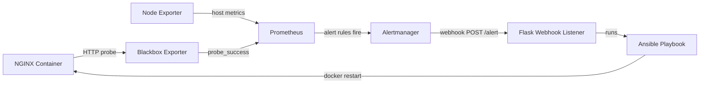

# Self-Healing Infrastructure with Prometheus, Alertmanager & Ansible

An automated detect-and-recover pipeline: when a service fails, Prometheus detects it, Alertmanager raises the alert, and an Ansible playbook restarts the service. No human intervention is needed.

---

## Table of Contents
1. [Overview](#overview)
2. [Architecture](#architecture)
3. [Tools Used](#tools-used)
4. [Project Structure](#project-structure)
5. [Prerequisites](#prerequisites)
6. [Setup and Installation](#setup-and-installation)
7. [Running the Demo](#running-the-demo)
8. [Results](#results)
9. [Configuration Explained](#configuration-explained)
10. [Troubleshooting](#troubleshooting)
11. [Future Improvements](#future-improvements)

---

## Overview

Manual recovery from service outages is slow and error-prone. This project implements **self-healing infrastructure**, where the system detects failures and fixes them automatically.

**What it does**
- Monitors an NGINX web server's uptime using the Blackbox Exporter.
- Monitors host CPU usage using Node Exporter.
- Fires alerts when NGINX is down or CPU stays above 90%.
- Sends alerts through an Alertmanager webhook to a Flask listener.
- The listener runs an Ansible playbook that restarts the failed service and verifies it is healthy again.

---

## Architecture



**Flow in words**

```
NGINX stops -> Blackbox probe fails -> Prometheus alert (Pending -> Firing)
-> Alertmanager sends webhook -> Listener runs Ansible -> NGINX restarts -> probe succeeds
```

> Alertmanager can only send notifications (webhooks, email, etc.). It cannot run Ansible directly, so the Flask listener acts as the bridge.

---

## Tools Used

| Tool | Role |
|---|---|
| **NGINX** | Sample service being monitored and healed |
| **Prometheus** | Collects metrics and evaluates alert rules |
| **Blackbox Exporter** | Probes NGINX over HTTP to check uptime |
| **Node Exporter** | Exposes host CPU and system metrics |
| **Alertmanager** | Groups alerts and sends them to the webhook |
| **Flask (Python)** | Webhook listener that triggers the remediation |
| **Ansible** | Runs the recovery playbooks |
| **Docker / Docker Compose** | Runs the monitoring stack |
| **WSL2 / Ubuntu** | Host environment |

---

## Project Structure

```
self-healing-infra/
├── docker-compose.yml          # NGINX + monitoring stack
├── ansible.cfg                 # Ansible defaults (optional)
├── prometheus/
│   ├── prometheus.yml          # Scrape jobs and Alertmanager target
│   └── alert.rules.yml         # NginxDown and HighCPU alert rules
├── alertmanager/
│   └── alertmanager.yml        # Routing and webhook receiver
├── blackbox/
│   └── blackbox.yml            # HTTP probe module
├── ansible/
│   ├── restart_nginx.yml       # Restart NGINX and verify
│   └── high_cpu.yml            # Capture top CPU processes
├── webhook/
│   └── listener.py             # Flask listener for Alertmanager
├── screenshots/                # Demo evidence
└── README.md
```

---

## Prerequisites

- Ubuntu (native, VM, or WSL2 on Windows)
- Docker and the Docker Compose plugin
- Ansible
- Python 3 with Flask
- Git
- Free ports: **8080** (NGINX), **9090** (Prometheus), **9093** (Alertmanager), **5001** (listener)

Install on Ubuntu/WSL:

```bash
sudo apt update
sudo apt install -y docker.io docker-compose-v2 ansible python3-pip python3-flask git stress
sudo usermod -aG docker $USER   # then log out and back in
```

---

## Setup and Installation

**1. Clone the repository**
```bash
git clone https://github.com/<your-username>/self-healing-infra.git
cd self-healing-infra
```

**2. Start the monitoring stack**
```bash
docker compose up -d
docker compose ps
```
All five containers (`nginx`, `prometheus`, `alertmanager`, `blackbox`, `node-exporter`) should show **Up**.

**3. Test the playbook manually**
```bash
ansible-playbook ansible/restart_nginx.yml
```
Expected result: `ok=3 changed=1 failed=0`.

**4. Start the webhook listener** (from the project root, in a separate terminal)
```bash
python3 webhook/listener.py
```

**5. Verify everything is up**

| Service | URL |
|---|---|
| NGINX | http://localhost:8080 |
| Prometheus targets | http://localhost:9090/targets |
| Prometheus alerts | http://localhost:9090/alerts |
| Alertmanager | http://localhost:9093 |

All Prometheus targets should be **UP**.

---

## Running the Demo

### Test A: Service failure (auto-restart)

Keep the Prometheus alerts page, Alertmanager, and the listener terminal visible, then run:

```bash
docker stop nginx
```

Expected timeline:

| Time | Event |
|---|---|
| ~0-5 s | `probe_success` drops to 0; alert is **Pending** |
| ~20 s | Alert is **Firing**; visible in Alertmanager |
| ~25 s | Listener logs `Received NginxDown (firing)` and runs the playbook |
| ~30 s | `docker ps` shows NGINX running again; http://localhost:8080 responds |

Check the log:
```bash
cat healing.log
```

### Test B: High CPU

```bash
stress --cpu $(nproc) --timeout 120
cat /tmp/high_cpu_report.log
```
The `HighCPU` alert fires after CPU stays above 90% for 1 minute, and the playbook records the top CPU-consuming processes.

---

## Results

| Metric | Value |
|---|---|
| Failure detection time | ~__ seconds |
| Alert fire time (`for: 15s`) | ~__ seconds |
| Total time to recovery | ~__ seconds |
| Manual steps needed | 0 |

### Screenshots

| Stage | Screenshot |
|---|---|
| All targets UP | `screenshots/01-targets-up.png` |
| NGINX running (before) | `screenshots/02-nginx-before.png` |
| Alert pending | `screenshots/03-alert-pending.png` |
| Alert firing | `screenshots/04-alert-firing.png` |
| Alertmanager received alert | `screenshots/05-alertmanager.png` |
| Listener and Ansible output | `screenshots/06-ansible-run.png` |
| NGINX recovered | `screenshots/07-nginx-recovered.png` |

<!-- Replace the table above with image embeds, for example:  -->

---

## Configuration Explained

**Alert rules** (`prometheus/alert.rules.yml`)

| Alert | Condition | Duration | Purpose |
|---|---|---|---|
| `NginxDown` | `probe_success == 0` | 15 s | Detects NGINX being unreachable |
| `HighCPU` | CPU usage > 90% | 1 min | Detects sustained CPU saturation |

The `for:` duration avoids **flapping** and false alarms caused by short blips.

**Alertmanager** (`alertmanager/alertmanager.yml`)
- `group_wait: 5s` keeps the delay before the first notification short.
- `repeat_interval: 1m` re-sends while the alert is still firing.
- `send_resolved: true` also notifies when the alert clears.

**Ansible playbook** (`ansible/restart_nginx.yml`)
1. Restarts the `nginx` container.
2. Prints the result.
3. Verifies NGINX returns HTTP 200, retrying up to 5 times.

---

## Troubleshooting

| Problem | Fix |
|---|---|
| `No such container: nginx` | The stack isn't running. Run `docker compose up -d`. |
| `container name "/prometheus" is already in use` | Remove the old container: `docker rm -f prometheus`, then `docker compose down && docker compose up -d`. |
| `port is already allocated` | Change the host port in `docker-compose.yml`, e.g. `"8081:80"`, and update the playbook URL. |
| Alertmanager cannot reach the listener | Ensure the listener binds to `0.0.0.0`, and that `extra_hosts: host.docker.internal:host-gateway` is set for Alertmanager. |
| Prometheus targets DOWN | Run `docker compose logs prometheus`; usually a YAML indentation issue. |
| `permission denied` on docker socket | Run `sudo usermod -aG docker $USER` and reopen the terminal. |
| Alert never fires | Check that the `job` label in the rule matches `nginx-blackbox`, and wait for the `for:` duration. |
| Config change not applied | `docker compose restart prometheus alertmanager` |

---

## Future Improvements

- Add Slack or email as a second Alertmanager receiver.
- Add escalation: if NGINX is still down after the restart, send a "manual attention needed" alert.
- Build a Grafana dashboard for uptime, CPU, and recovery events.
- Protect the webhook endpoint with a shared secret token.
- Run NGINX as a systemd service and use Ansible's `service` module.
- Extend remediation to multiple hosts using an Ansible inventory.

---

## Key Concepts Demonstrated

- **Self-healing infrastructure:** detect, decide, act.
- **Pull-based monitoring** with Prometheus and PromQL.
- **Blackbox (external) vs. whitebox (internal) monitoring.**
- **Alert routing and webhooks** with Alertmanager.
- **Idempotent, agentless automation** with Ansible.
- **Infrastructure as code** with Docker Compose and YAML configuration.

---

*Built as part of the 2-week DevOps internship project: Self-Healing Infrastructure with Prometheus, Alertmanager & Ansible.*
